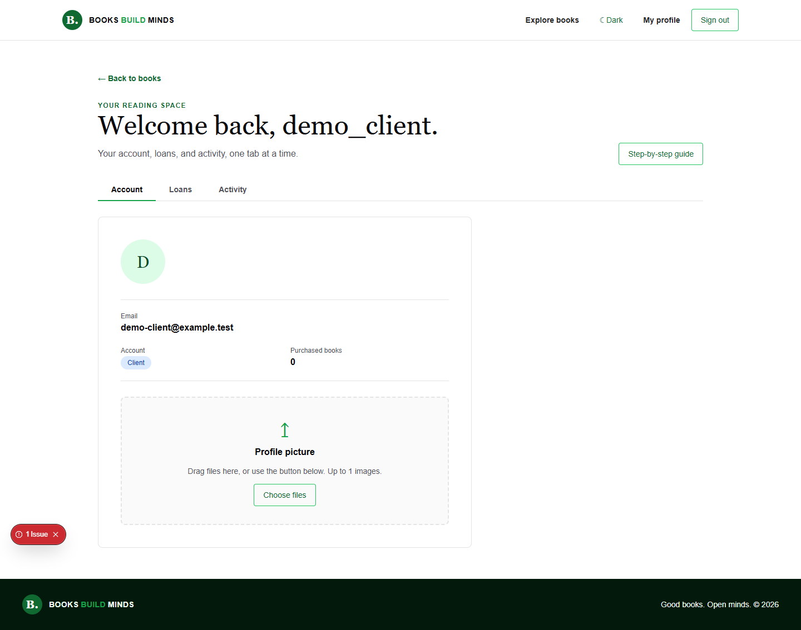
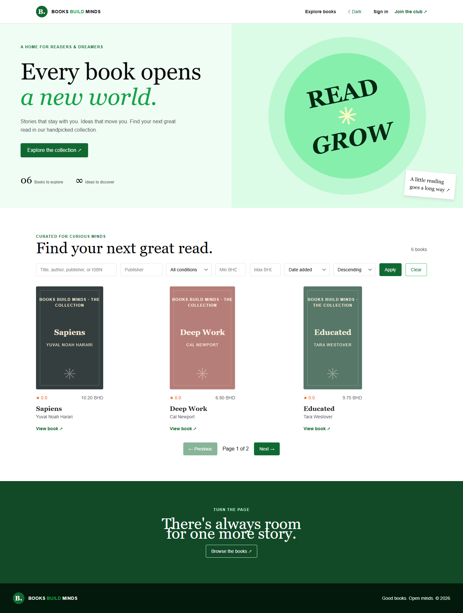
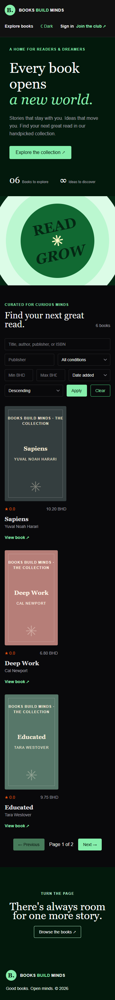

# Books Builds Minds — client repository

This is the **client** repository for Books Builds Minds. The matching [server repository](https://github.com/HussainALAradi5/books_build_minds_server/blob/main/README.md) provides the catalog, authentication, permissions, uploads, workflows, and demo data. The [documentation repository](https://github.com/HussainALAradi5/books_build_minds_documentation/blob/main/README.md) describes each service and endpoint. The related repository links point to the published GitHub repositories.

## Related repositories

| Repository | GitHub link | What it contains |
| --- | --- | --- |
| Client | This repository | Next.js pages, Chakra UI components, hooks, typed API services, and screenshots |
| Server | [Open server repository](https://github.com/HussainALAradi5/books_build_minds_server/blob/main/README.md) | Flask API, business rules, PostgreSQL models, migrations, and demo seeding |
| Documentation | [Open documentation repository](https://github.com/HussainALAradi5/books_build_minds_documentation/blob/main/README.md) | Setup guides and feature-by-feature service and endpoint references |

The related repository links point to the published GitHub repositories.

## Preview

The latest [Chakra UI tabs and workflow guides](docs/screenshots/tabs/README.md) organize profile, administration, access management, and book detail sections.



Read the [security controls and deployment requirements](https://github.com/HussainALAradi5/books_build_minds_documentation/blob/main/security/README.md) before exposing a live service.





[View all desktop, mobile, light, and dark screenshots](docs/screenshots/README.md).

The [workflow screenshots](docs/screenshots/workflows/README.md) show registration, borrowing, purchase and receipt access, reviews, employee profile, and admin management.

## Run locally

Node.js 20.9+ is required.

1. Follow the [server setup](https://github.com/HussainALAradi5/books_build_minds_server/blob/main/README.md) to run Flask and seed the test accounts.
2. Install client dependencies and create local configuration:

   ```powershell
   Copy-Item .env.example .env.local
   npm ci
   ```

3. Set both `BACKEND_URL` and `NEXT_PUBLIC_BACKEND_URL` in `.env.local` to the Flask origin, normally `http://127.0.0.1:5000`. The first is used by server functions; the second loads media and connects Socket.IO in the browser.
4. Start Next.js with `npm run dev`, then open `http://localhost:3000`.

The client has no separate demo catalog; `flask --app app seed-demo --test-accounts` populates server data. Never commit `.env.local`.

## Test the user journeys

After running `seed-demo --test-accounts` on the server, sign in at `/login`:

| Role | Username | Password | Try this |
| --- | --- | --- | --- |
| Administrator | `demo_admin` | `LibraryAdmin2026!` | Open **Admin** to manage books, inventory, authors, publishers, roles, groups, and permissions. |
| Employee | `demo_employee` | `LibraryStaff2026!` | Browse books, borrow or rent, purchase, and manage your own profile. Admin pages remain restricted. |
| Client | `demo_client` | `LibraryReader2026!` | Borrow or rent a book, return it, purchase a book, download its receipt, then write a review. |

Anonymous visitors can browse the catalog and reviews, and register as a client. The seeded `demo_visitor` record is inactive and cannot sign in. Employees currently start with the same member permissions as clients; an admin can assign extra roles or groups through access management. See the [step-by-step workflow guide](docs/screenshots/workflows/README.md).

## Structure

| Path | Purpose |
| --- | --- |
| `src/app` | Thin Next.js route pages and layouts |
| `src/features` | Feature view composition and access guards |
| `src/Components/custom` | Reusable Chakra UI buttons, forms, tables, filters, pagination, dialogs, and upload controls |
| `src/Components/*` | Feature render components, including the admin access page |
| `src/hooks` and `src/providers` | State, actions, and feature context |
| `src/services` | Typed API functions using the shared `apiClient` |
| `src/interfaces`, `src/props`, `src/enums` | Client contracts, component props, enum labels and colors |
| `src/server` | Protected Next.js server functions and backend request forwarding |
| `docs/screenshots` | Desktop and mobile light/dark screenshots |

The browser uses typed service functions and an HttpOnly session cookie. Public catalog and review reads work without a session. The API enforces all protected actions; client guards only control what the user sees. Reviews combine a rating, comment, and optional description, and require a purchase.

## Verify

```powershell
npm run typecheck
npm run lint
npm run build
```

See the [screenshot index](docs/screenshots/README.md) and the [feature documentation](https://github.com/HussainALAradi5/books_build_minds_documentation/blob/main/README.md). The repositories have no GitHub remote configured yet; add each remote after creating the corresponding GitHub repository.

## Print a book record

On a book page, choose **Download book PDF** or **Show QR and barcode**. The server generates both codes and the printable document. Use a keyboard-mode scanner in catalog search to find the printed inventory identifier. See [printing setup](https://github.com/HussainALAradi5/books_build_minds_documentation/blob/main/features/books/printing/README.md).
