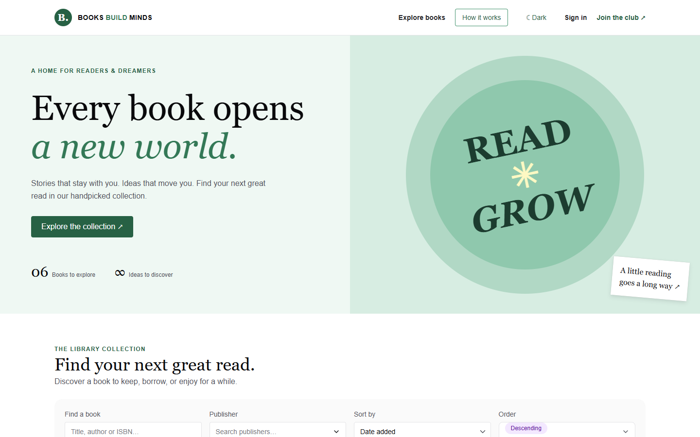
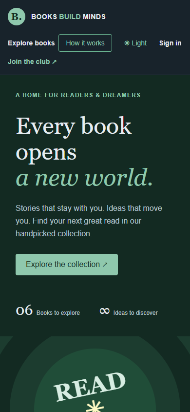
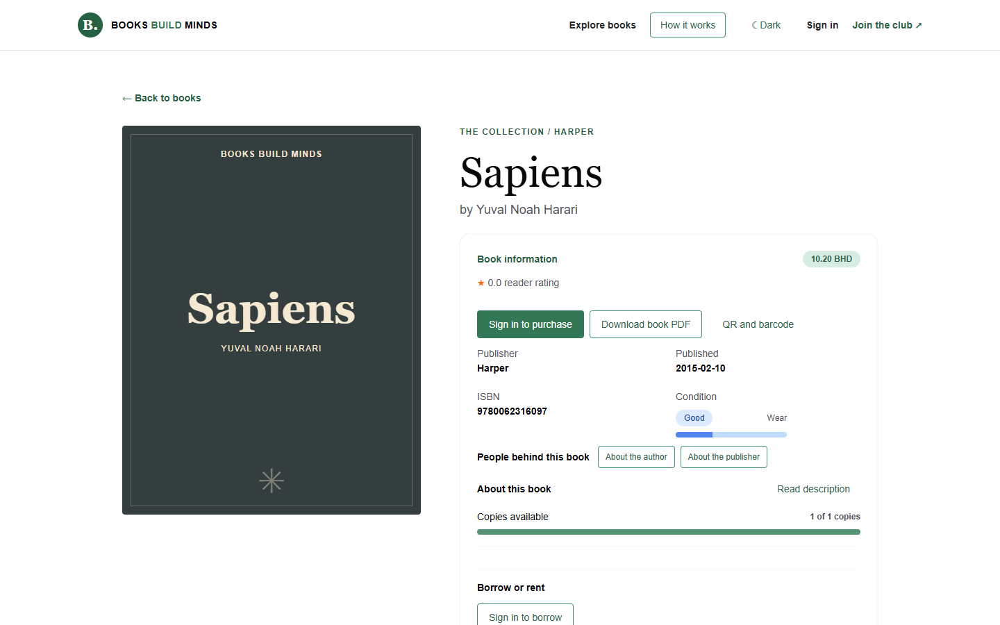
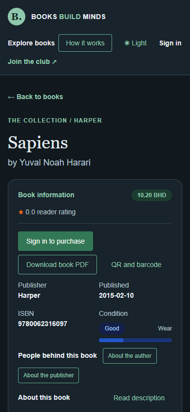
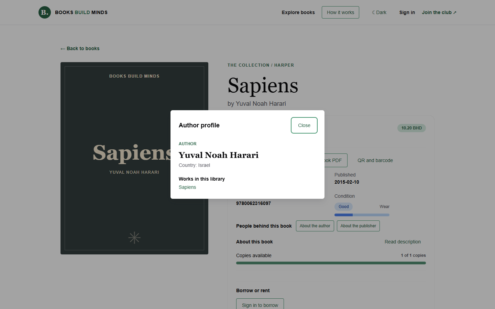
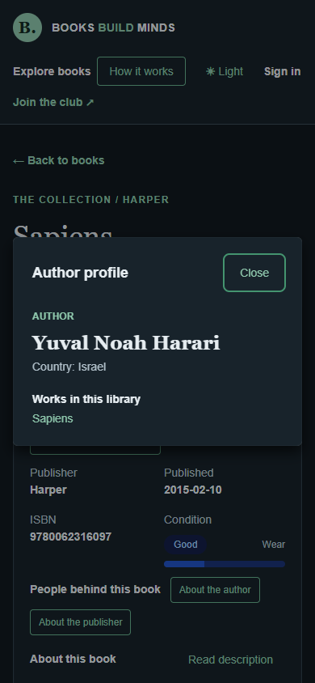
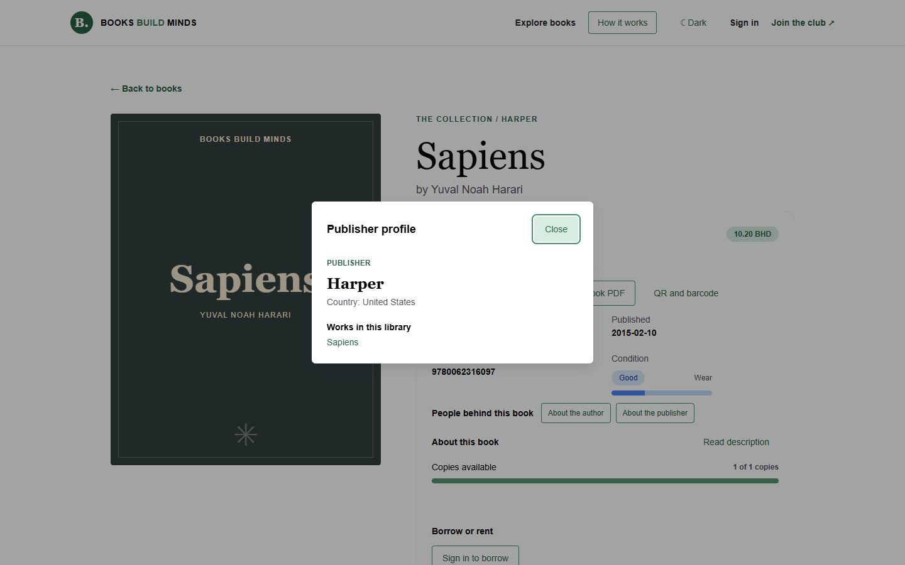
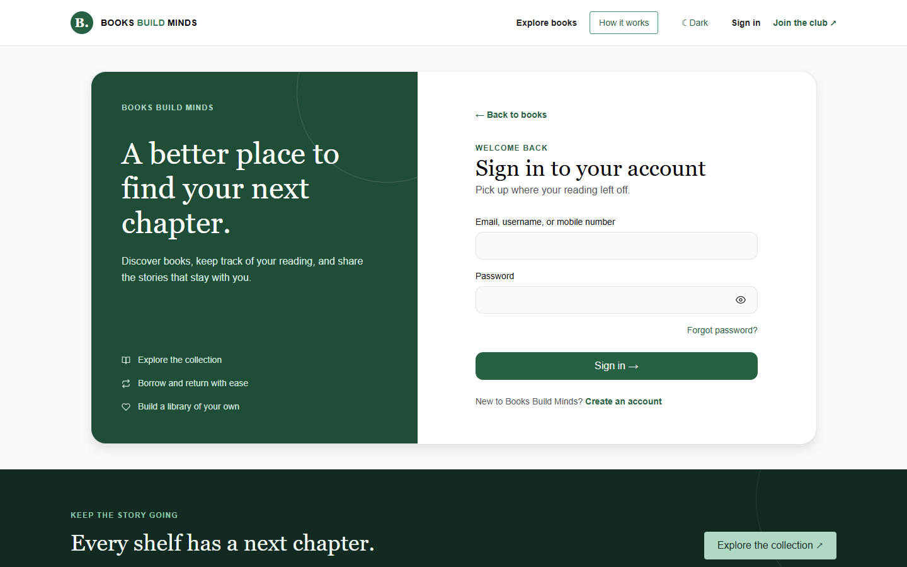
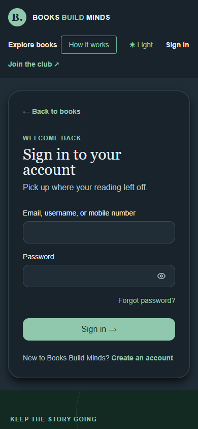
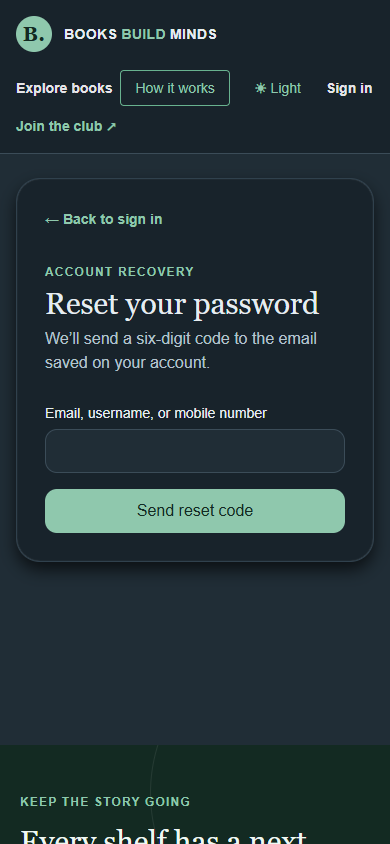

# Books Builds Minds — client repository

This is the **client** repository for Books Builds Minds. The matching [server repository](https://github.com/HussainALAradi5/books_build_minds_server/blob/main/README.md) provides the catalog, authentication, permissions, uploads, workflows, and demo data. The [documentation repository](https://github.com/HussainALAradi5/books_build_minds_documentation/blob/main/README.md) describes each service and endpoint. The related repository links point to the published GitHub repositories.

## Related repositories

| Repository | GitHub link | What it contains |
| --- | --- | --- |
| Client | This repository | Next.js pages, Chakra UI components, hooks, typed API services, and screenshots |
| Server | [Open server repository](https://github.com/HussainALAradi5/books_build_minds_server/blob/main/README.md) | Flask API, business rules, PostgreSQL models, migrations, and demo seeding |
| Documentation | [Open documentation repository](https://github.com/HussainALAradi5/books_build_minds_documentation/blob/main/README.md) | Setup guides and feature-by-feature service and endpoint references |

The related repository links point to the published GitHub repositories.

## Preview

Chakra UI tabs and workflow guides organize profile, administration, access management, and book detail sections.

Read the [security controls and deployment requirements](https://github.com/HussainALAradi5/books_build_minds_documentation/blob/main/security/README.md) before exposing a live service.

The catalog has responsive book cards, a searchable publisher filter, condition badges, a grid/list switch, and administrator table actions.

The catalog list and book page show a copy-availability bar based on available and total copies. A separate, labeled wear scale uses the book's condition category (New, Good, Fair, or Damaged) without presenting it as a measured percentage. The reusable animated progress bar also marks each step of the library workflow and guide.

On a book page, small **About the author** and **About the publisher** buttons open read only profiles with country, description, and works. Reviews appear below. A reusable information card near the title shows publisher, publication date, ISBN, and condition. Administrators can change an existing book's price in a compact dialog. Other book fields and existing creator profiles are fixed after creation.

The information card also shows the price as a badge, the book's real description from the server, copy availability, and purchase, PDF, borrowing, and rental actions. Purchase and PDF appear together near the book facts. On narrow screens, the details and actions come before the cover so readers can act without scrolling past a tall image. A small **How it works** guide lives in the navbar. Reviews hide soft-deleted entries by default. Administrators can turn on **Show deleted reviews** to inspect marked, read-only deleted entries; the server rejects this filter for other roles.

## Screenshots

Current desktop and mobile captures from the client and a local Flask preview (19 October 2026). The mobile views use dark mode. Demo book records and account recovery are shown without real payments or email delivery.

| View | Desktop | Mobile |
| --- | --- | --- |
| Home |  |  |
| Book details |  |  |
| Author information |  |  |
| Publisher information |  | — |
| Sign in |  |  |
| Password recovery | — |  |

The [screenshot index](docs/screenshots/README.md) links to earlier catalog, profile, access, and library workflow captures.

## Run locally

Use Node.js 24 for this project (pinned in `.nvmrc` and `package.json`). The client build and type checks are verified on Node 24. On this Windows environment, Node 25.2.1 produced `EPERM` errors writing build output. Select Node 24 in your terminal before running npm commands.

Development and production builds use separate generated directories, so `npm run build` can run while the development server is open.

1. Follow the [server setup](https://github.com/HussainALAradi5/books_build_minds_server/blob/main/README.md) to run Flask and seed the test accounts.
2. Install client dependencies and create local configuration:

   ```powershell
   Copy-Item .env.example .env.local
   npm ci
   ```

3. Set both `BACKEND_URL` and `NEXT_PUBLIC_BACKEND_URL` in `.env.local` to the Flask origin, normally `http://127.0.0.1:5000`. The first is used by server functions; the second loads media and connects Socket.IO in the browser.
4. Start Next.js with `npm run dev`, then open `http://localhost:3000`.

Start Flask before opening the client. Check `http://127.0.0.1:5000/api/?per_page=3` in your browser; it should return JSON. If Flask is stopped or `BACKEND_URL` points to another port, the home page shows a connection message and **Try again** instead of crashing. Restart the server and reload the page.

The client has no separate demo catalog; `flask --app app seed-demo --test-accounts` populates server data. Never commit `.env.local`.

Catalog search, sorting, pagination, and **Reset filters** request fresh results from Flask through Next.js's same-origin `/catalog-data` proxy. They update the book results in place without navigating or reloading the page.

## Test the user journeys

After running `seed-demo --test-accounts` on the server, sign in at `/login`:

| Role | Username | Password | Try this |
| --- | --- | --- | --- |
| Administrator | `demo_admin` | `LibraryAdmin2026!` | Open **Admin** to add books and manage catalog records, roles, groups, and permissions; change an existing book's price from its detail page. |
| Employee | `demo_employee` | `LibraryStaff2026!` | Browse books, borrow or rent, purchase, and manage your own profile. Admin pages remain restricted. |
| Client | `demo_client` | `LibraryReader2026!` | Borrow or rent a book, return it, purchase a book, download its receipt, then write a review. |

Anonymous visitors can browse the catalog and reviews, and register as a client. The seeded `demo_visitor` record is inactive and cannot sign in. Employees currently start with the same member permissions as clients; an admin can assign extra roles or groups through access management.

Sign in with email, username, or an optional international mobile number and a required password. **Forgot password?** sends a six-digit code to the account's saved email, even when the username or mobile number identifies it. Configure server-side email delivery before using the reset page; the client never receives the code from the API.

## Structure

| Path | Purpose |
| --- | --- |
| `src/app` | Thin Next.js route pages and layouts |
| `src/features` | Feature view composition and access guards |
| `src/Components/custom` | Reusable Chakra UI buttons, forms, tables, filters, pagination, dialogs, and upload controls |
| `src/Components/*` | Feature render components, including the admin access page |
| `src/hooks` and `src/providers` | State, actions, and feature context |
| `src/services` | Typed API functions using the shared `apiClient` |
| `src/interfaces`, `src/props`, `src/enums` | Client contracts, component props, enum labels and colors |
| `src/server` | Protected Next.js server functions and backend request forwarding |
| `docs/screenshots` | Desktop and mobile light/dark screenshots |

The browser uses typed service functions and an HttpOnly session cookie. Public catalog and review reads work without a session. The API enforces all protected actions; client guards only control what the user sees. Reviews combine a rating, comment, and optional description, and require a purchase.

## Verify

```powershell
npm run typecheck
npm run lint
npm run build
```

See the [feature documentation](https://github.com/HussainALAradi5/books_build_minds_documentation/blob/main/README.md).

## Print a book record

On a book page, choose **Download book PDF** or **Show QR and barcode**. The server generates both codes and the printable document. Use a keyboard-mode scanner in catalog search to find the printed inventory identifier. See [printing setup](https://github.com/HussainALAradi5/books_build_minds_documentation/blob/main/features/books/printing/README.md).

## Guided borrowing and BHD sandbox payments

Borrowing now requires a server quote, accepted library terms and final confirmation. Purchases and rentals use Tap's BHD sandbox with persisted transactions and immutable PDF receipts. Delete/bulk changes use confirmation dialogs; failed changes remain visible for retry.

See [payment setup, services, endpoint contracts and release limits](https://github.com/HussainALAradi5/books_build_minds_documentation/blob/main/features/payments/README.md). Configure `TAP_SECRET_KEY` and the public HTTPS `TAP_WEBHOOK_URL` on the server. Live keys are rejected. Real sandbox verification still requires your own provider account and webhook. No secrets belong in the client repository.
