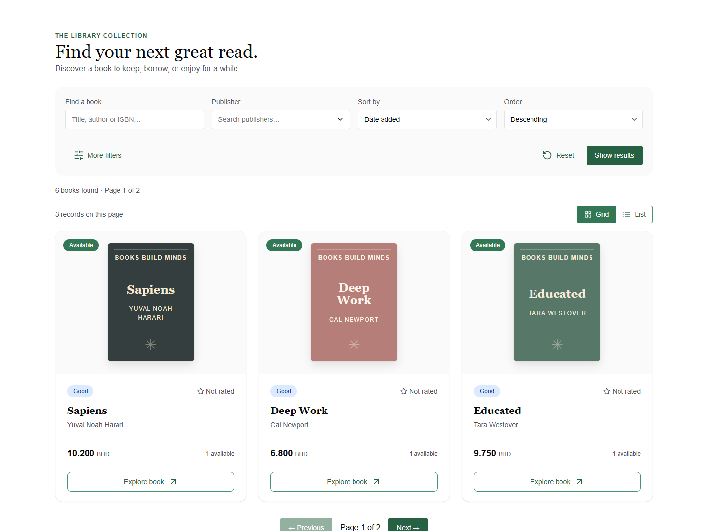
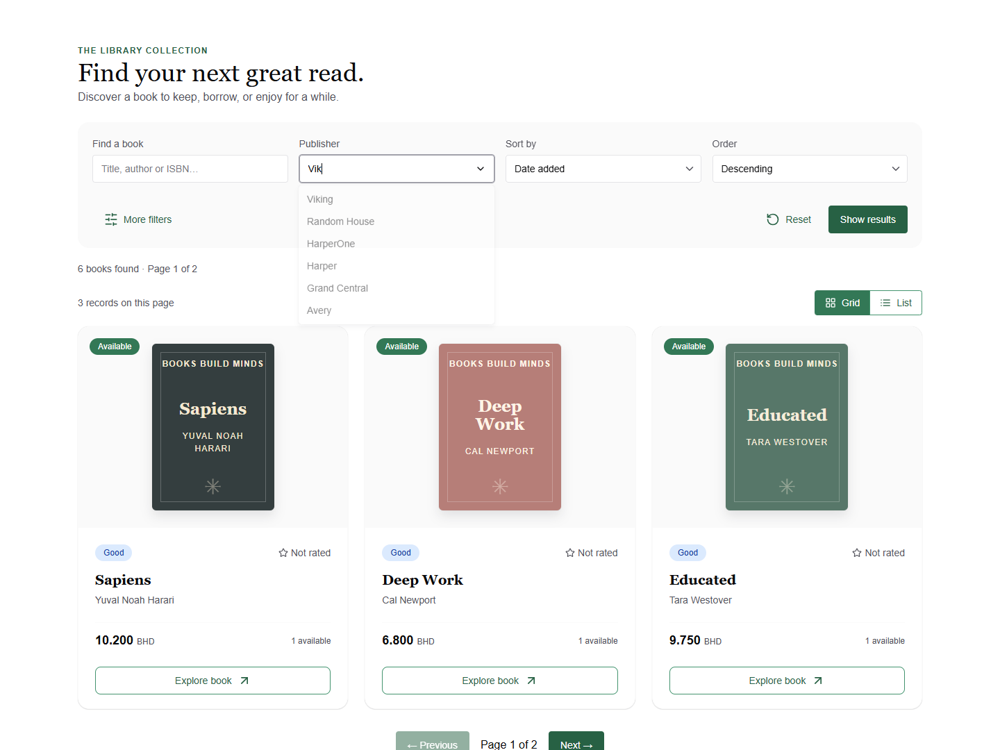
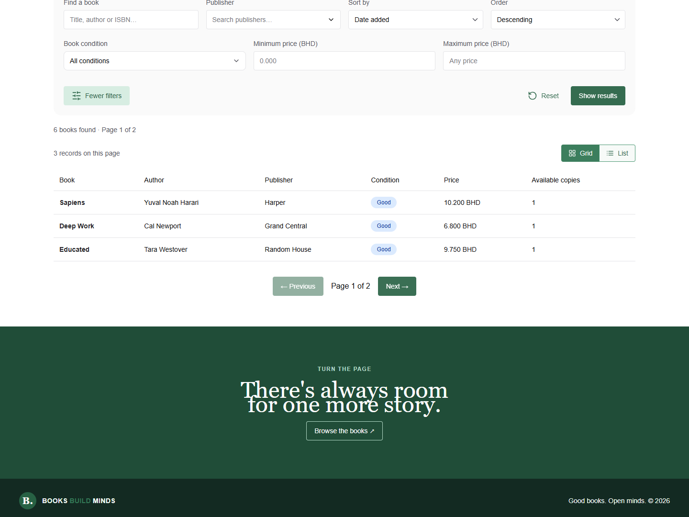
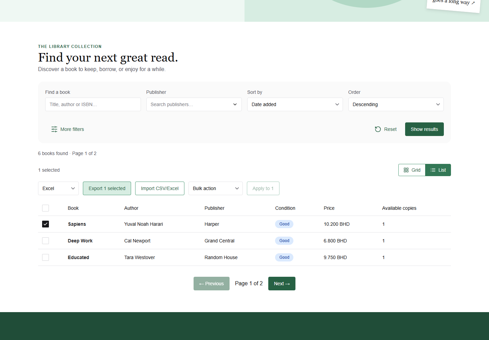
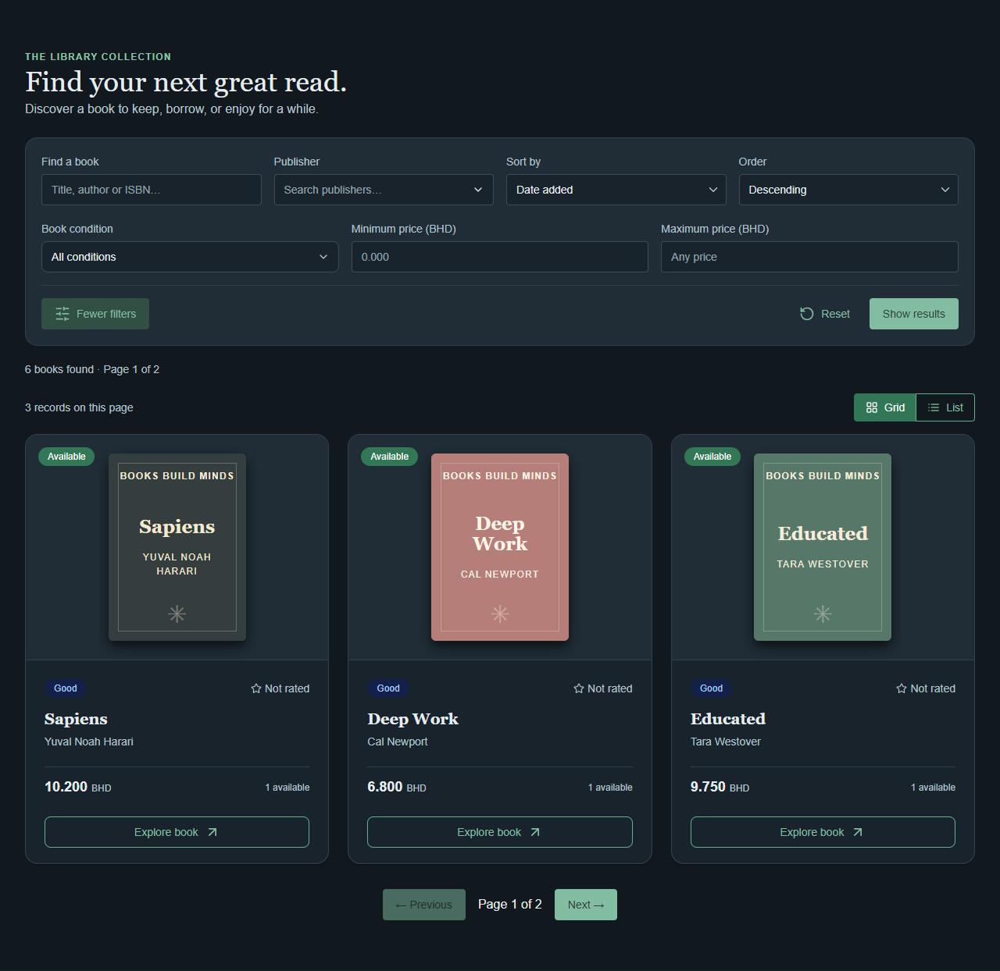
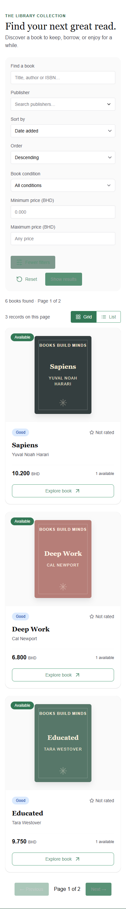
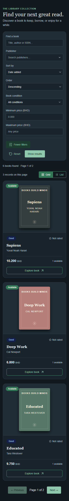
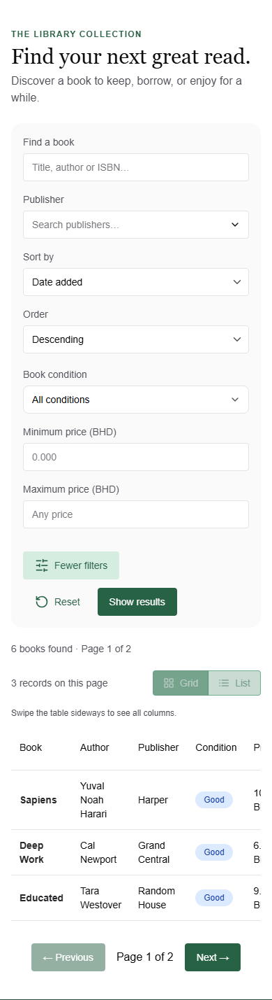

# Catalog screenshots

Captured on 16 October 2026 from the Next.js client with an isolated, server-seeded Flask database. The gallery shows the real catalog API and test accounts. Desktop width is 1440px; mobile width is 390px.

| View | Screenshot |
| --- | --- |
| Reader grid, light |  |
| Searchable publisher dropdown |  |
| Reader list, light |  |
| Administrator list with row selection and import/export |  |
| Reader grid, dark |  |
| Mobile grid, light |  |
| Mobile grid, dark |  |
| Mobile list, light |  |

The grid/list switch and table action controls are reusable across `GenericTable` consumers. Export uses the server endpoint and respects selected rows; only an administrator with the corresponding permissions sees import and bulk actions. Import and bulk changes are enforced by the server.
