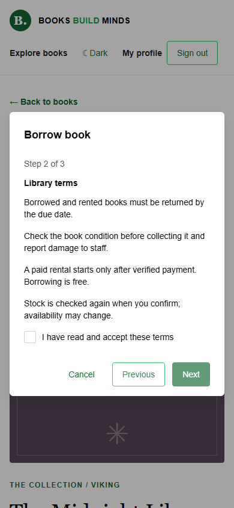
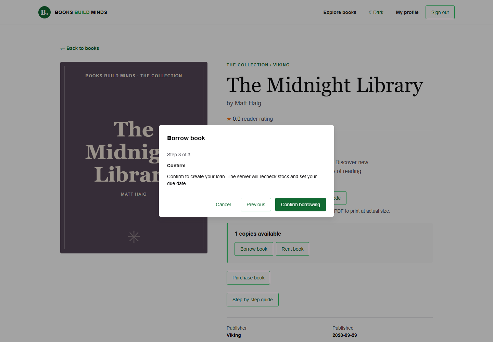
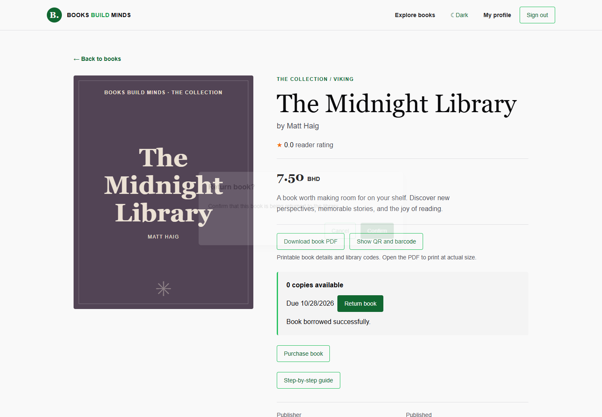
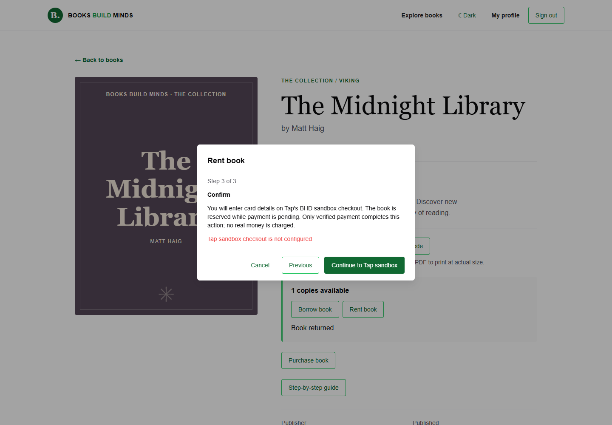
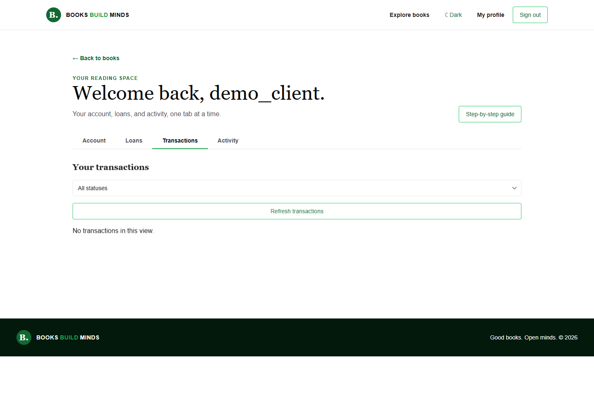
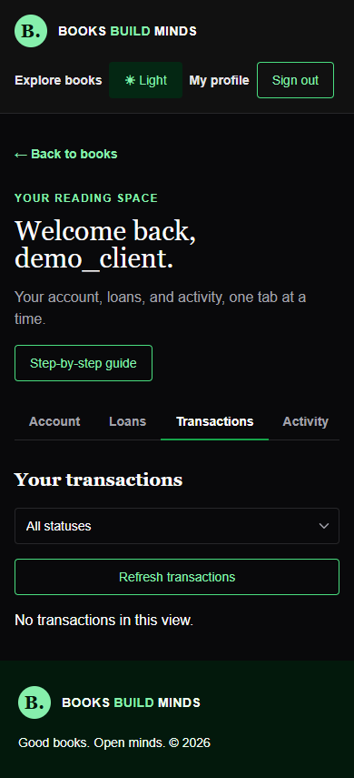

# Guided library and payment screens

Captured from the application on 15 October 2026 using isolated server-seeded test data. Mobile width: 390px; desktop width: 1440px. These screenshots demonstrate application workflows, not a completed external Tap payment.

## Borrow: review → accept terms → confirm

The terms step disables Next until accepted. Cancelling does not create a loan.

## Return confirmation

## Sandbox setup guard

Missing payment credentials produce an actionable error without creating ownership or a rental. The dialog stays open.

## Transactions

The profile has a dedicated transaction tab with server filtering, refresh, hosted-checkout resume and receipt downloads when applicable. These images show the empty state after the free borrowing test.

See the [server setup guide](https://github.com/HussainALAradi5/books_build_minds_documentation/blob/main/features/payments/setup/README.md) to configure your Tap sandbox account and verify a real hosted checkout.
