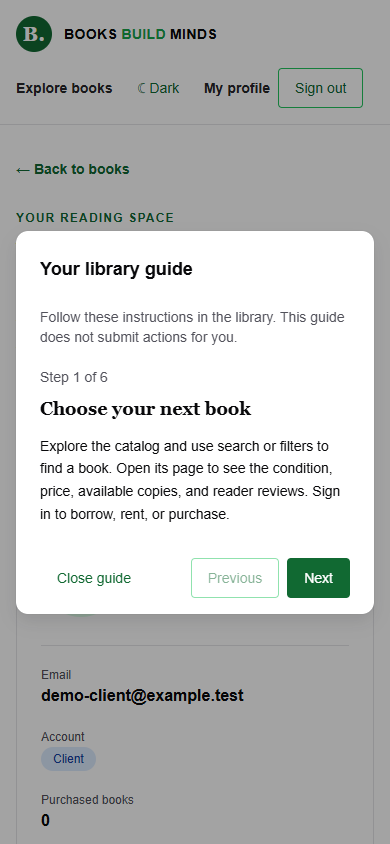

# Chakra UI tabs and guides

These screenshots show the current tabbed layouts, using a temporary server database with demo accounts.

| View | Light | Dark |
| --- | --- | --- |
| Profile account, desktop | [View](profile-desktop.png) | [View](profile-desktop-dark.png) |
| Profile loans | [View](profile-loans.png) | [View](profile-loans-dark.png) |
| Profile account, mobile | [View](profile-mobile.png) | [View](profile-mobile-dark.png) |
| Written workflow guide, mobile | [View](guide-mobile.png) | [View](guide-mobile-dark.png) |
| Admin inventory, desktop | [View](admin-desktop.png) | [View](admin-desktop-dark.png) |
| Access management, mobile | [View](access-mobile.png) | [View](access-mobile-dark.png) |

Use the profile tabs to switch between Account, Loans, and Activity. The administration and access pages have their own tabs. Select **Step-by-step guide** for written instructions with Previous, Next, and Done controls. The guide does not perform transactions.

See the [component documentation](https://github.com/HussainALAradi5/books_build_minds_documentation/blob/main/architecture/ui-components.md) and [security documentation](https://github.com/HussainALAradi5/books_build_minds_documentation/blob/main/security/README.md). Earlier workflow screenshots show the previous stacked layout; their underlying actions remain available through these tabs.
