# Test the library workflows

These images show the running client using the Flask API. To reproduce them, run the [server](https://github.com/HussainALAradi5/books_build_minds_server/blob/main/README.md), start the [client](../../../README.md), and seed the documented local accounts with `seed-demo --test-accounts`. The screenshots use **Sapiens**; choose another unpurchased book if that account has already completed a step.

## 1. Join or sign in

Open `/register` to create a client account, or `/login` to use a demo account. Registration always starts with the client role.

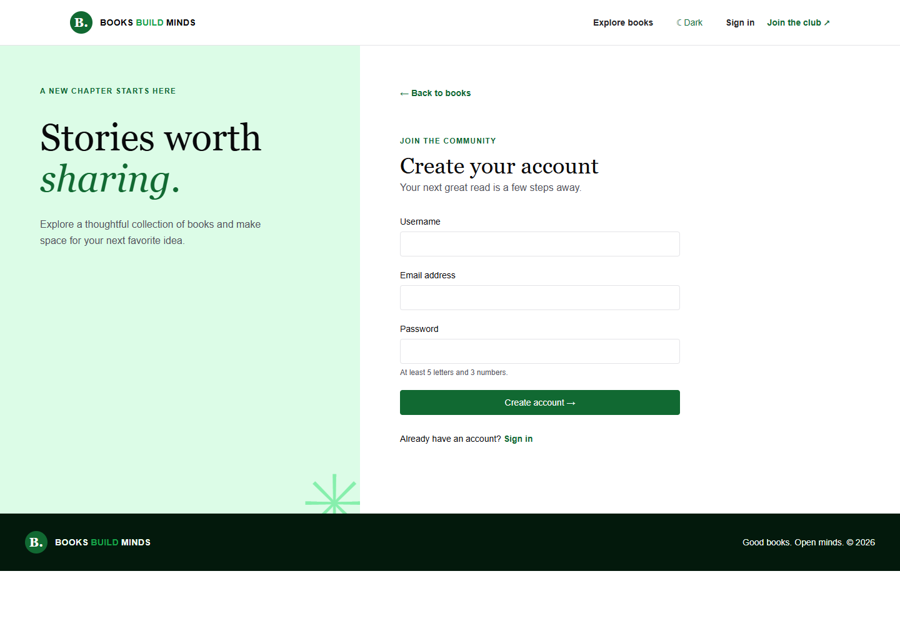

## 2. Use a client account

Sign in as `demo_client` with `LibraryReader2026!`. Open **My profile** to see account details, loans, and activity.

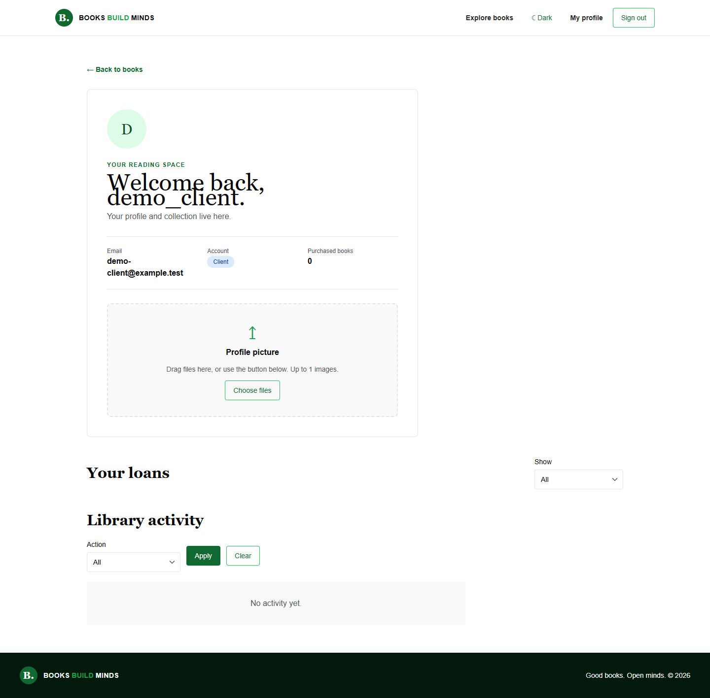

Select a book from **Explore books**. The detail page shows available copies, borrow and rent terms, purchase, and the review requirement.

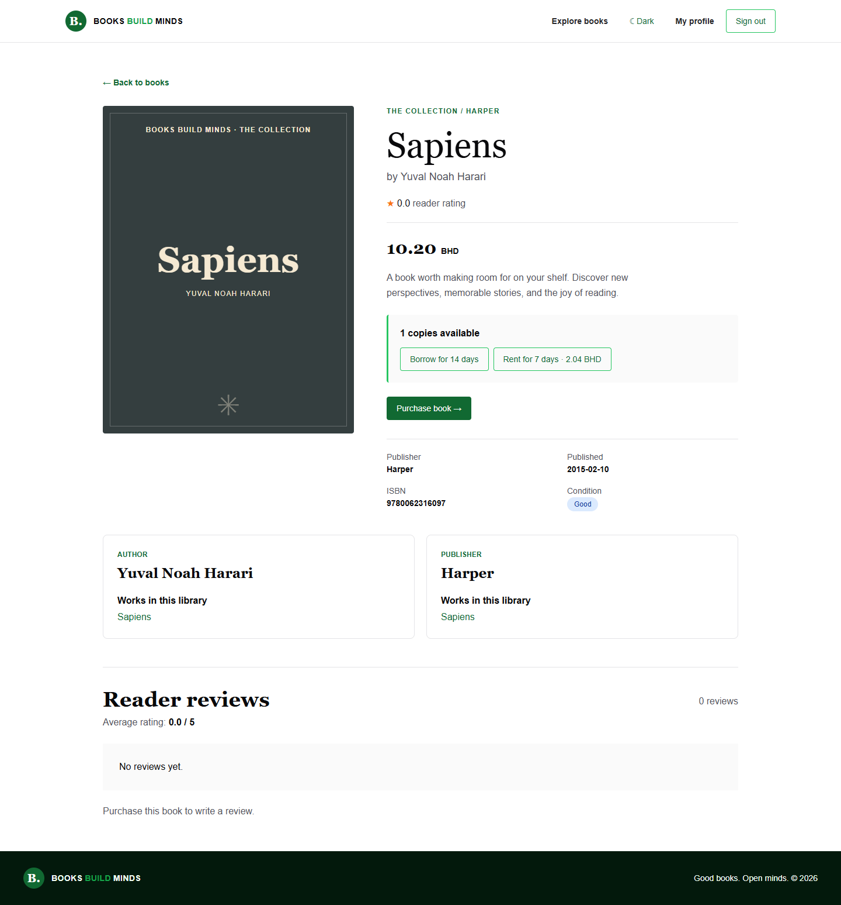

Choose **Borrow for 14 days** or **Rent for 7 days**. The book then shows its due date and **Return book**; the loan also appears in **My profile**.

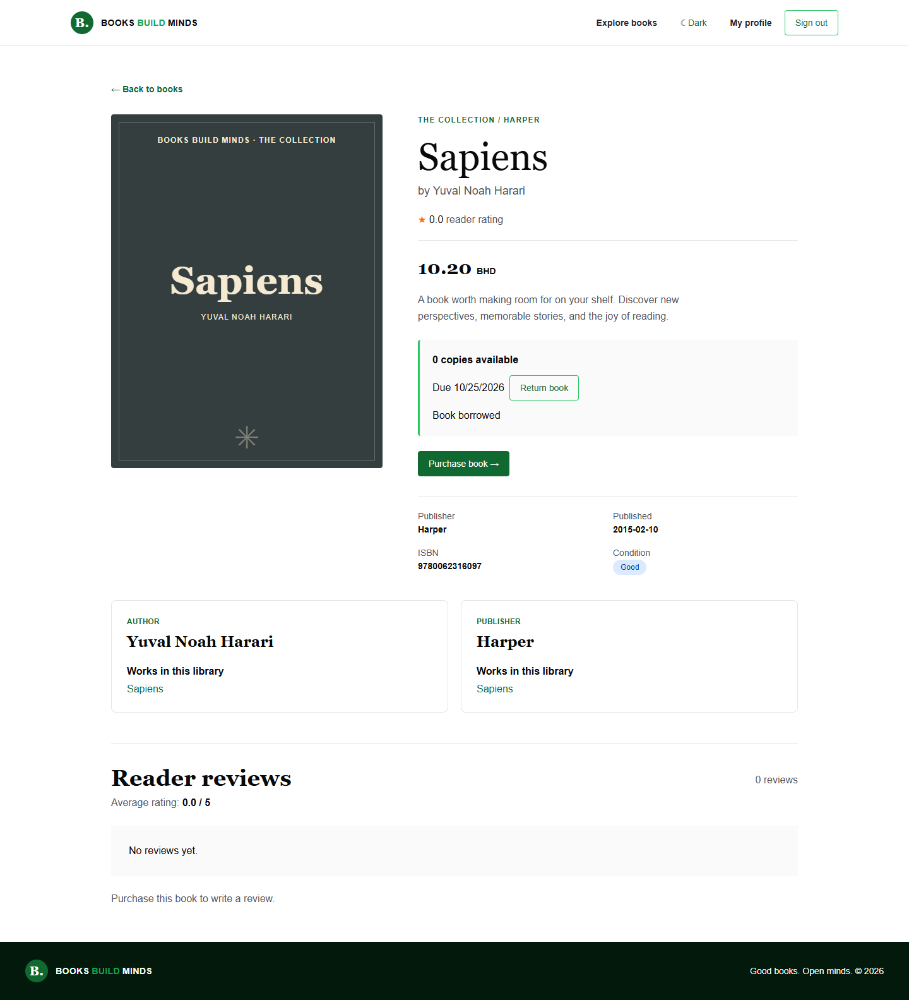

On another available book, choose **Rent for 7 days**. The rental appears as an active loan with its due date.

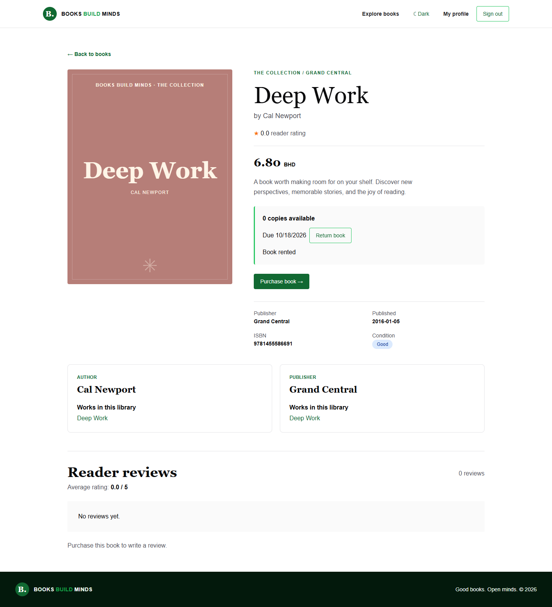

Choose **Return book** to close that rental and make the copy available again.

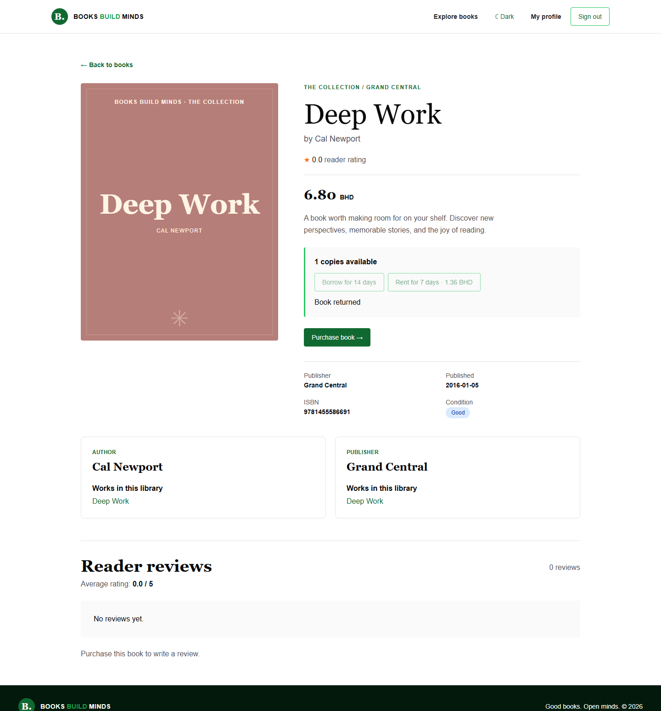

Choose **Purchase book**. The page now offers **Download receipt**, and the review form becomes available. Pick 1–5 stars, write at least 10 characters, and submit.

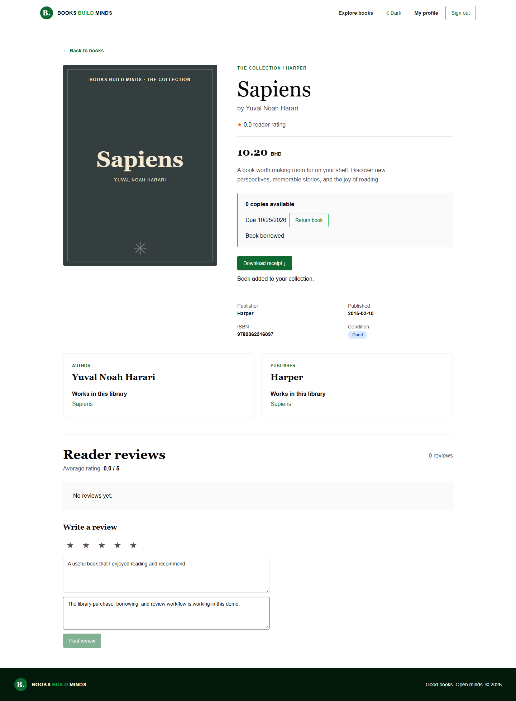

The posted review shows its rating and text. The reviewer can edit or soft delete their own review; an administrator can soft delete a review, but cannot edit its text. One active review per purchased book is allowed.

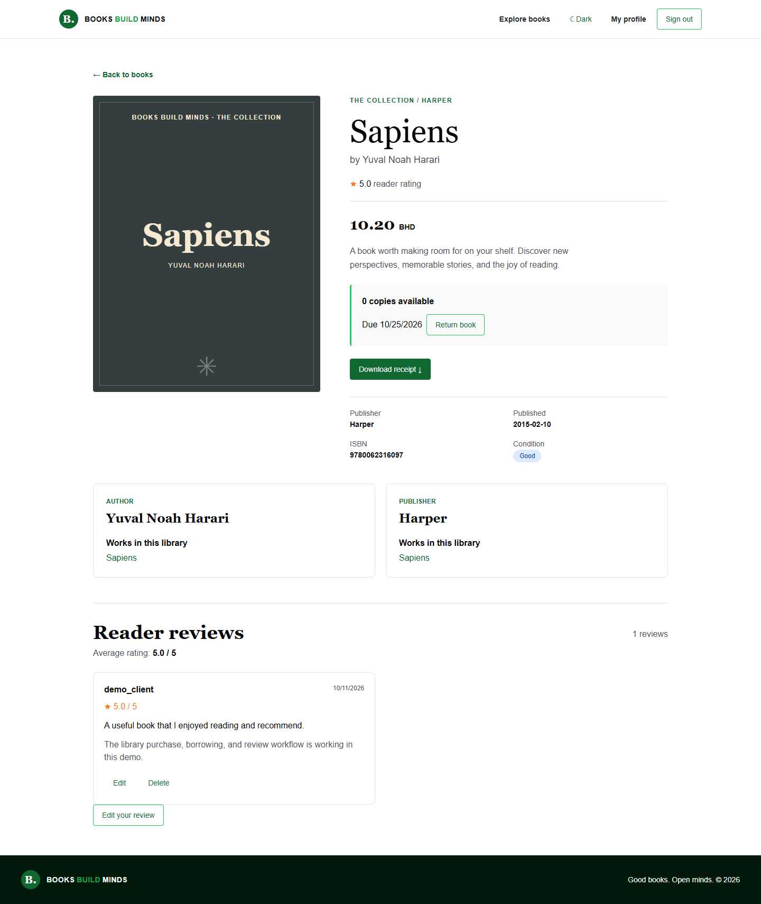

The same detail page uses a single column on a narrow screen.

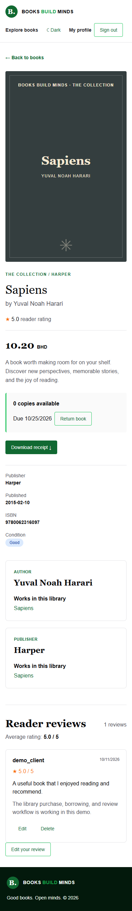

The updated profile shows the loan, purchase count, and library activity. Use **Return** in the loan table to finish the borrow or rent workflow.

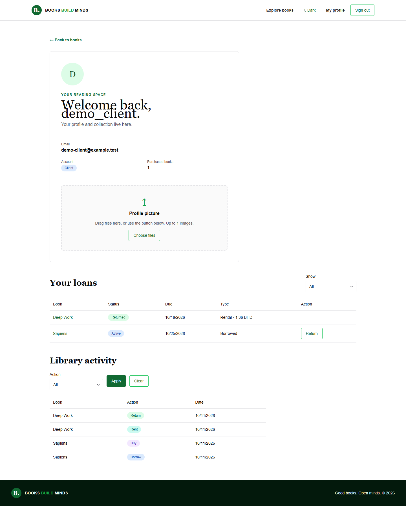

## 3. Use an employee account

Sign in as `demo_employee` with `LibraryStaff2026!`. Employees currently have member permissions: they can use their own profile and the reader workflows. They do not see the administrator dashboard by default; an administrator may assign extra access roles or groups.

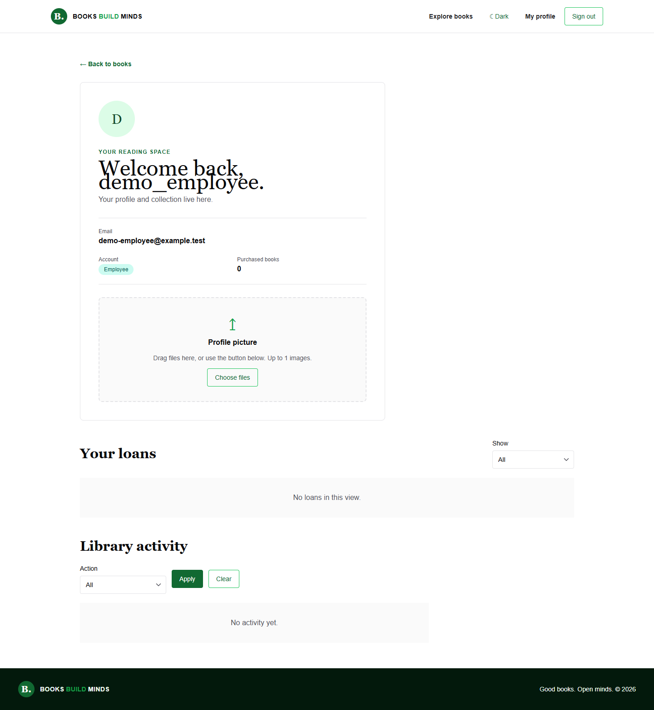

## 4. Use an administrator account

Sign in as `demo_admin` with `LibraryAdmin2026!`. Open **Admin** to add or edit books and catalog records, filter inventory, import/export rows, apply bulk archive or soft delete, and review access requests.

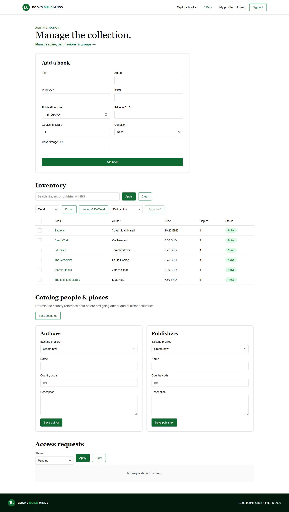

Choose **Manage roles, permissions & groups** to inspect permissions, roles, groups, and user assignments. This page and its API require the administrator account role.

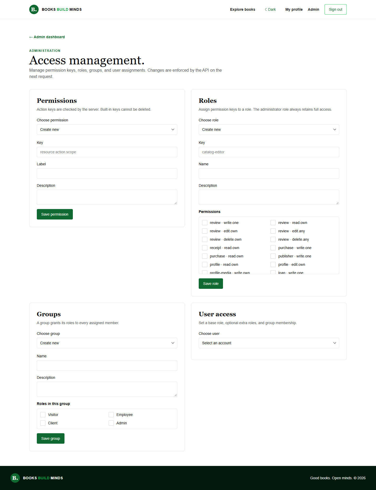

## Other screenshots

The [screenshot index](../README.md) also includes desktop and mobile light/dark views of the home, book, login, and access pages.

## Refreshed interaction checks — 2026-10-18

These screenshots were captured from the production client build with the local Flask API. Resetting catalog filters updates only the results. The book page uses available copies to color its progress bar, and the guide shows animated progress through its six steps.

| Interaction | Screenshot |
| --- | --- |
| Catalog after Reset filters | [Desktop](catalog-reset-desktop.png) |
| Availability indicator | [Desktop](book-availability-desktop.png) · [Mobile dark](book-availability-mobile-dark.png) |
| Step-by-step guide | [Desktop](workflow-progress-desktop.png) |
| Owner edits inside the review card | [Desktop](review-inline-edit-desktop.png) |
| Administrator sees Delete but no Edit | [Desktop](review-admin-delete-desktop.png) |
